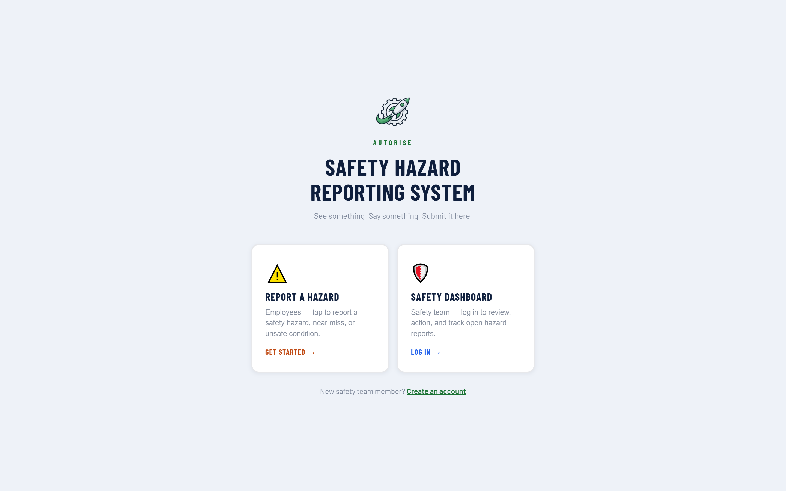
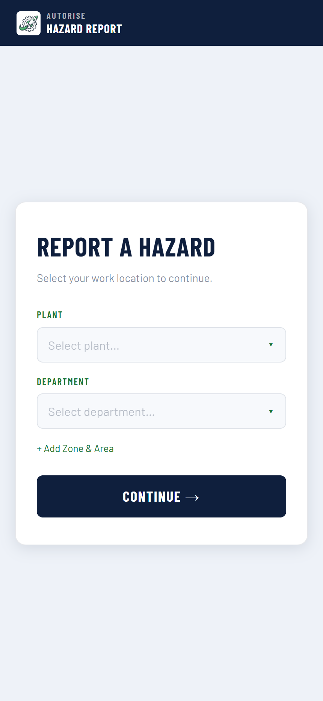
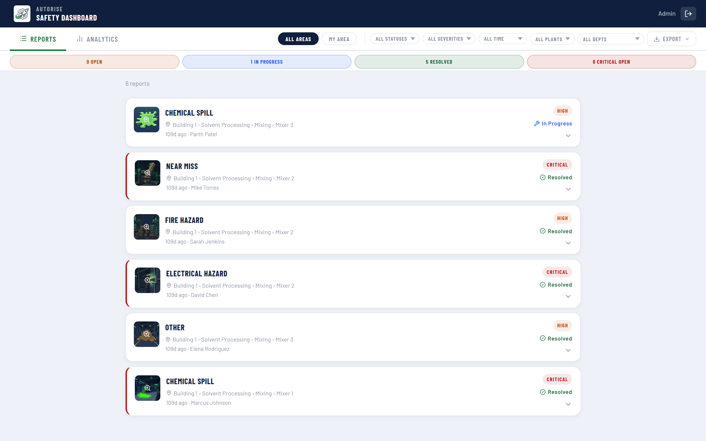

# SHRS — Safety Hazard Reporting System

*Sanitized snapshot of my private repository (20 commits, Apr to Aug 2026), published Aug 2026 as a code sample. Provisioning scripts were left out, and it contains no client data or secrets.*

**Plant-floor workers report hazards from their phones. The safety team assigns and tracks each one on a realtime dashboard.**

[**Live demo →**](https://shrs.autoriseconsulting.com/autorise) · part of a multi-tenant suite built for small and mid-market operations teams

---

## The problem

In many plants, hazard reporting still runs on paper forms that can take days to reach a
safety manager, by which point the hazard is either resolved or has caused an injury. When a
report is slow to file, near-misses often go unreported.

## What it does

- **Photo-first capture on mobile** — the camera opens straight from the report form
- **Hazard type and severity grid** — large tap targets chosen for gloved hands, not mouse precision
- **Realtime safety dashboard** — new reports appear without a refresh
- **Assignment and status workflow** — route a report to a specific safety team member and track it to closure
- **Analytics** — trend charts by type, severity and area to surface the pattern behind repeat reports
- **PDF and CSV export** — for audits and safety committee meetings
- **Mobile FAB filter sheet** — full filtering on a phone without a desktop layout

## Screenshots

### Landing — report or review



### Hazard capture (mobile)



### Safety dashboard



## Stack

React 19 · Vite 8 · Supabase (PostgreSQL + Realtime + Storage) · Recharts · CSS Modules · Cloudflare Pages

## Architecture

Every tenant is isolated by `company_id` with the company `slug` carried in the URL, so a
single deployment serves any number of organisations without a per-client build.

```
Browser (React 19 + Vite)
   |
   |-- anon key, governed by Row Level Security
   v
Supabase
   +-- PostgreSQL   tenant-scoped tables, RLS policies per company
   +-- Realtime     dashboards update without polling
   +-- Storage      photo uploads on a public read bucket
```

**Design decisions worth calling out**

- **Tenant resolution from the URL.** `/:companySlug` resolves the company once and hydrates
  branding, location vocabulary and feature flags from a single row. Adding a client is a
  database insert, not a deployment.
- **Branding is data, not code.** Logo and brand colours live on the company record. A
  `ensureContrast()` helper darkens any supplied brand colour until it clears WCAG AA (4.5:1)
  against its background, so a client with a pale yellow brand still gets readable UI.
- **Configurable location vocabulary.** One plant calls it Plant / Department / Zone / Line,
  another calls it Site / Area / Cell / Station. Labels and option lists are stored per company
  in JSONB rather than hardcoded.
- **The anon key is the only credential in the browser.** All privileged operations are either
  RLS-permitted or handled server-side. A service-role key is never given a `VITE_` prefix,
  because Vite inlines every `VITE_*` variable it finds referenced in client source, which
  would publish the key inside the JS bundle.
- **Realtime over polling.** Supervisor dashboards subscribe to Postgres changes, so a
  submission from the floor appears without a refresh.

## Running it locally

```bash
npm install
cp .env.example .env.local   # add your own Supabase project URL + anon key
npm run dev
```

Apply the SQL in `supabase/` to your own project first, then visit `/your-company-slug`.
The schema builds on the `companies` and `managers` tables shared with SRTS, which this
repo does not create.

```bash
npm run build     # production build
```

Deployed on Cloudflare Pages. `public/_redirects` contains the SPA fallback
(`/* /index.html 200`) so client-side routes survive a hard refresh.

## Notes

This is a portfolio copy of a system running in production. Operational provisioning
scripts and all client data are excluded; the application code, database schema and
architecture are intact.

Built by [Parth Patel](https://www.linkedin.com/in/parth-patel-83273a28a) — AutoRise LLC.
